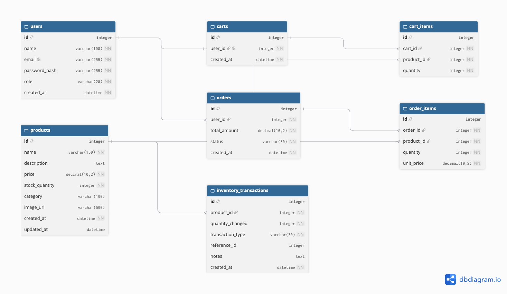

# Storefront & Inventory Management

A full-stack e-commerce application that combines an online storefront with an inventory management system.

## Overview

We created this project to better understand how a full-stack web application is designed, developed, and integrated. Our goal was to build an application that combines the functionality of an online store with the administrative tools needed to manage products, inventory, and customer orders.

The application is designed for two types of users: customers and administrators. Customers can create accounts, browse products, manage their shopping carts, and complete simulated purchases. Administrators can manage products, update inventory, and review customer orders.

Throughout this project, we applied concepts covered in CS465P, including frontend development, backend development, RESTful APIs, database management, authentication, and application integration.

## Application Architecture

The application was developed using a three-layer architecture that separates the frontend, backend, and database.

### Frontend

The frontend is built using React, JavaScript, JSX, and CSS. React components are used to create reusable interfaces, manage application state, and handle user interactions.

### Backend

The backend is built using Node.js and Express. It handles HTTP requests, application logic, authentication, authorization, and communication with the database through RESTful API endpoints.

### Database

SQLite is used to store and manage application data, including user accounts, products, shopping carts, orders, and inventory transactions.

## Technology Stack

| Category | Technologies |
|----------|-------------|
| Frontend | React, JavaScript, JSX, CSS |
| Backend | Node.js, Express.js |
| Database | SQLite, SQL |
| API | RESTful API, Fetch API |
| Authentication | Session-based authentication, bcryptjs |
| Development Tools | Vite, ESLint, npm |
| Version Control | Git, GitHub |
| Development Environment | VS Code |

## Features

### User Authentication

- Customer account registration
- User login and logout
- Secure password hashing
- Session-based authentication
- Persistent user sessions
- Customer and administrator roles
- Role-based access control
- Form validation and error handling

### Customer Storefront

- Retrieve product information from the database
- View product images, descriptions, prices, and stock quantities
- View individual product details
- Display active products
- Responsive user interface

### Shopping Cart

- Add products to the shopping cart
- Increase and decrease product quantities
- Remove products from the shopping cart
- Calculate item subtotals and order totals
- Validate quantities against available inventory
- Save shopping cart information to the database
- Maintain shopping cart contents across user sessions

### Checkout

- Review products and quantities before checkout
- Display the final order total
- Validate product availability and inventory before placing an order
- Complete simulated purchases
- Generate order confirmation
- Clear the shopping cart after successful checkout

### Admin Product Management

- View active and inactive products
- Add new products
- Edit existing products
- Update product names, descriptions, prices, categories, and images
- Update product stock quantities
- Activate and deactivate products
- Validate product information
- Prevent duplicate product SKUs
- Store and retrieve product information from the database

Products are deactivated rather than permanently deleted to preserve product records associated with previous orders.

### Inventory Management

- Monitor available stock quantities
- Update inventory levels
- Prevent out-of-stock products from being added to the cart
- Prevent cart quantities from exceeding available inventory
- Display inventory warnings
- Prevent checkout when cart items are invalid
- Automatically deduct inventory after successful purchases
- Record inventory additions, sales, and stock adjustments
- Maintain consistent product and inventory records through database transactions

Inventory is deducted only after an order has been successfully processed, rather than when products are added to the shopping cart.

### Order Management

- Create and store customer orders
- Record purchased products, quantities, and prices
- Associate orders with customer accounts
- Maintain order records in the database
- Display order confirmations
- Allow administrators to view customer orders
- Allow administrators to review order details and statuses

The application is designed to simulate purchases and does not process real payments.

## Development Status

The application is currently under active development.

## Project Structure

```
Storefront-Inventory-Management/
├── frontend/
│   ├── public/
│   │   ├── images/
│   │   └── favicon.svg
│   ├── src/
│   │   ├── components/
│   │   │   └── ProductCard.jsx
│   │   ├── pages/
│   │   │   ├── AdminProducts.jsx
│   │   │   ├── Login.jsx
│   │   │   ├── ProductDetails.jsx
│   │   │   ├── Register.jsx
│   │   │   └── ShoppingCart.jsx
│   │   ├── services/
│   │   │   ├── auth.js
│   │   │   └── products.js
│   │   ├── App.jsx
│   │   ├── App.css
│   │   ├── index.css
│   │   └── main.jsx
│   ├── .gitignore
│   ├── eslint.config.js
│   ├── index.html
│   ├── package-lock.json
│   ├── package.json
│   └── vite.config.js
│
├── backend/
│   ├── config/
│   │   ├── database.js
│   │   └── session.js
│   ├── controllers/
│   │   ├── authController.js
│   │   └── productController.js
│   ├── database/
│   │   ├── schema.sql
│   │   └── seed.js
│   ├── middleware/
│   │   └── authMiddleware.js
│   ├── routes/
│   │   ├── authRoutes.js
│   │   └── productRoutes.js
│   ├── app.js
│   ├── package-lock.json
│   └── package.json
│
├── docs/
│   ├── DATABASE_SETUP.md
│   ├── FRONTEND_SETUP.md
│   ├── ER-diagram.pdf
│   └── ER-diagram.png
├── .env.example
├── .gitignore
└── README.md
```

### Directory Overview

| Directory | Description |
|-----------|-------------|
| `frontend/` | React frontend application |
| `frontend/public/` | Product images and static resources |
| `frontend/src/components/` | Reusable React components |
| `frontend/src/pages/` | Application pages and user interfaces |
| `frontend/src/services/` | Frontend communication with authentication and product APIs |
| `backend/` | Node.js and Express backend application |
| `backend/config/` | Database, session, and application configuration |
| `backend/controllers/` | Request handling and application logic |
| `backend/database/` | Database schema, seed data, and database storage |
| `backend/middleware/` | Authentication, authorization, and request processing |
| `backend/routes/` | RESTful API endpoint definitions |
| `docs/` | Project documentation, setup guides, and database diagrams |

### Entity-Relationship Diagram



## Prerequisites

Before setting up the application, make sure the following are installed:

- Node.js
- npm
- Git
- SQLite

## Getting Started

### Clone the Repository

git clone https://github.com/NawasNo/Storefront-Inventory-Management.git
cd Storefront-Inventory-Management

### Backend Setup

Refer to the [Database Setup and Testing Guide](docs/DATABASE_SETUP.md) for instructions on configuring environment variables, installing backend dependencies, initializing the database, and running the backend.

### Frontend Setup

Refer to the [Frontend Setup and Testing Guide](docs/FRONTEND_SETUP.md) for instructions on installing frontend dependencies, configuring the frontend, and running the application.

Both the frontend and backend must be running for the application to function correctly.

## Additional Libraries

The following libraries are used to support backend functionality:

| Library | Purpose |
|---------|---------|
| [better-sqlite3](https://github.com/WiseLibs/better-sqlite3) | SQLite database operations |
| [bcryptjs](https://github.com/dcodeIO/bcrypt.js) | Password hashing |
| [express-session](https://github.com/expressjs/session) | User session management |
| [better-sqlite3-session-store](https://www.npmjs.com/package/better-sqlite3-session-store) | Persistent session storage |
| [cors](https://github.com/expressjs/cors) | Cross-origin resource sharing |
| [dotenv](https://github.com/motdotla/dotenv) | Environment variable configuration |
| [nodemon](https://nodemon.io/) | Automatic backend server restarts |

## Documentation

Detailed project documentation is available in the `docs/` directory.

| Document | Description |
|----------|-------------|
| [Frontend Setup and Testing](docs/FRONTEND_SETUP.md) | Frontend installation, configuration, and testing |
| [Database Setup and Testing](docs/DATABASE_SETUP.md) | Backend and database configuration, seed data, Product API, inventory management, and testing |
| [Entity-Relationship Diagram (PDF)](docs/ER-diagram.pdf) | Database design and table relationships |
| [Entity-Relationship Diagram (PNG)](docs/ER-diagram.png) | Visual representation of the database design |

## Team Members

### Nawas Noradeen

**Frontend Development and Product Management API**

- Frontend architecture and development
- Application layout and styling
- Product catalog and Product Details page
- Admin Product Management interface
- Shopping cart and checkout review interface
- Frontend login and registration
- Frontend authentication API integration
- Role-based frontend navigation
- Product Management API
- Frontend Product API integration
- Product inventory transaction management
- Frontend testing and documentation

### Neha Marlady

**Backend Development and Database Management**

- Backend architecture and development
- SQLite database design and implementation
- Database schema and seed data
- Entity-relationship diagram
- User registration and authentication API
- Password hashing and session management
- Authentication and authorization middleware
- Shopping Cart API
- Order processing API
- Backend and database testing and documentation

Both team members contribute to project planning, code reviews, application integration, testing, and documentation.